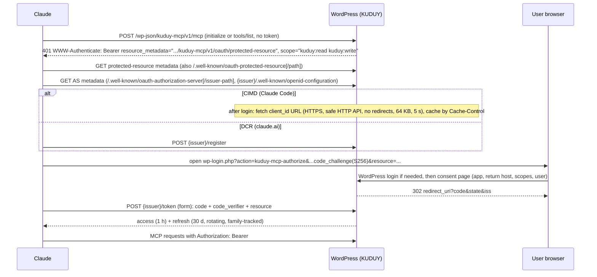

# KUDUY MCP — Architecture

Approved 2026-11-04 (decisions D1–D6); D1 and D2 changed by user decision during Phase 3. This file describes what is **built** (Phase 3 foundation and the start of Phase 4, v0.2.0) and what is **designed but not built yet** (marked *planned*). Research behind each decision: `RESEARCH.md`.

## 1. Goals and non-goals

- Native PHP WordPress plugin, GPL-2.0-or-later, no KUDUY cloud service, no Node.js on the WordPress host.
- MCP **2026-07-28 and 2025-11-25** (dual-era) over Streamable HTTP at `https://<site>/wp-json/kuduy-mcp/v1/mcp`.
- OAuth 2.1 authorization server inside WordPress; every tool runs **as the WordPress user who approved the connection**, limited by that user's capabilities and the granted scopes.
- Self-update from GitHub Releases of `kuduyDigital/KuDiagnostics`.
- Non-goals for v1: arbitrary shell execution by default; network-wide multisite administration (see §12).

## 2. Decisions

| ID | Decision | Status |
|---|---|---|
| D1 | MCP wire layer: **own thin JSON-RPC layer** (`src/Mcp/`) behind a `ToolRegistry`. `wordpress/mcp-adapter` 0.7 deprecates bundling, and exposing tools as core Abilities would let other MCP servers call them without our OAuth scopes. | Changed 2026-11-04 (user). Built. |
| D2 | OAuth core: **own minimal authorization server** (`src/OAuth/`). `league/oauth2-server` 9.4 needs PHP 8.2 and lacks `resource`, CIMD, revocation and family revoke. | Changed 2026-11-05 (user). Built. |
| D3 | Minimum PHP 8.1, WordPress 6.9; tested up to 7.1.4 | Built |
| D4 | Code execution off by default: only with `define( 'KUDUY_MCP_ALLOW_CODE_EXEC', true )` + scope `kuduy:code` + `manage_options` and `unfiltered_html`/`edit_plugins` | Scope exists; tools *planned* (Phase 7) |
| D5 | Updates via core `Update URI` + `update_plugins_github.com`; ZIP + SHA-256 asset verified before install | Built |
| D6 | Tests: local PHP + Composer for static checks, WordPress Playground CLI for integration, public HTTPS site for real Claude clients | Built (Playground + Cloudflare tunnel; user's Hostinger staging site) |
| D7 | Elementor editing: own tools on Elementor's public document API, Elementor's own MCP abilities, or a hybrid (see `docs/plans/phase-5-elementor.md`) | **Decided 2026-11-05 (user): hybrid** — own tools on the public document API for documents, v3 + v4 editing, Kit, CSS and verification; Elementor's own abilities for v4 extras (global classes, variables) on 4.3+, behind `is_available()` |

## 3. Components

```mermaid
flowchart LR
  subgraph Clients
    A["claude.ai / Desktop / mobile"]
    B["Claude Code"]
  end
  subgraph WP["WordPress + KUDUY MCP"]
    G["Http/OutputGuard: buffer on own routes"]
    O["OAuth: metadata, authorize, token, register, revoke"]
    T["OAuth/TokenAuth: determine_current_user + route guard"]
    M["Mcp/RestController + Server: dual-era JSON-RPC"]
    R["Mcp/ToolRegistry"]
    P["Policy: scope, capability, rate limit"]
    X["Mcp/Executor: validate, check, snapshot, run, redact, audit"]
    subgraph Modules
      C["Core (built: site info, snapshots, update check)"]
      E["Elementor (planned)"]
      S["SEO + media (planned)"]
      W["WooCommerce + integrations (planned)"]
      D["Developer mode (planned)"]
    end
    J["Jobs (planned)"]
    L[("Audit log")]
    K[("Snapshots")]
    U["Update/GitHubUpdater"]
    H["Admin: Tools > KUDUY MCP (hidden mode planned)"]
  end
  A & B -->|HTTPS| G --> O
  G --> T --> M --> R --> P --> X --> Modules
  X --> L
  X --> K
  Modules --> J
  U -->|releases API| GH[("github.com/kuduyDigital/KuDiagnostics")]
```



## 4. Folder structure (as built)

```
kuduy-mcp/                       repo root = plugin root
├─ kuduy-mcp.php                 header (Version, Requires, Update URI), autoload, OutputGuard, hooks
├─ uninstall.php                 keeps data unless KUDUY_MCP_DELETE_DATA_ON_UNINSTALL
├─ src/
│  ├─ Plugin.php                 wiring only (VERSION, boot, hooks)
│  ├─ Lifecycle/                 Migrations (dbDelta, DB_VERSION), Deactivator, Uninstaller, Cleanup (daily cron)
│  ├─ Http/OutputGuard.php       drops stray output on our routes; 202/405 without body
│  ├─ Mcp/                       Tool, ToolError, ToolRegistry, Executor, Server, RestController
│  ├─ OAuth/                     Urls, Scopes, Clients (DCR + CIMD), Tokens, TokenAuth, Authorize, Endpoints
│  ├─ Policy/RateLimiter.php
│  ├─ Execution/                 Snapshottable, Snapshots
│  ├─ Audit/                     AuditLog, Redactor
│  ├─ Admin/                     Connections, ConnectionsPage (Tools > KUDUY MCP)
│  ├─ Update/GitHubUpdater.php
│  └─ Modules/Core/              SiteInfo, SnapshotList, SnapshotRestore, CheckUpdate, Content (shared), PostTypes, PostList, PostGet, TermList
├─ scripts/                      test-integration, smoke-mcp, tunnel, build-release, check-release, check-update
├─ tests/integration/            PHPUnit inside Playground; tests/playground blueprint; tests/phpstan stub
└─ .github/workflows/            ci.yml, release.yml
```

*Planned:* `src/Modules/{Core/*, Elementor/, Seo/, Woo/, Acf/, Forms/, Blocks/, Dev/}`, `src/Jobs/`, `src/Admin/HiddenMode.php`, `src/Admin/Cli.php`, `assets/admin/`, `languages/`. Rule: modules depend on `Mcp\Tool`, `Policy` and `Execution`, never on each other.

## 5. Database schema (DB version 1)

Custom tables only where options or meta do not fit (high write volume, queries, revocation). Created by `Lifecycle\Migrations` on activation and on boot when the stored version is older (auto-updates do not run activation hooks).

| Table | Columns | Why a table |
|---|---|---|
| `{p}kuduy_oauth_clients` | `client_id` PK, `type` (dcr/cimd), `name`, `redirect_uris` JSON, `metadata_url`, `metadata_cache` JSON, `created_at`, `last_used_at` | Many DCR rows; CIMD cache |
| `{p}kuduy_oauth_codes` | `code_hash` PK, `client_id`, `user_id`, `redirect_uri`, `scope`, `resource`, `challenge`, `expires_at`, `used` | Single use, 5 min |
| `{p}kuduy_oauth_tokens` | `id`, `token_hash` UNIQUE, `type` (access/refresh), `family_id`, `client_id`, `user_id`, `scope`, `resource`, `expires_at`, `revoked_at`, `replaced_by` | Rotation, reuse detection, revocation |
| `{p}kuduy_audit_log` | `id`, `ts`, `user_id`, `client_id`, `tool`, `args_redacted`, `result` (ok/error/denied), `error_code`, `duration_ms`, `object_type`, `object_id`, `snapshot_id` | High write, filterable, retention |
| `{p}kuduy_snapshots` | `id`, `ts`, `user_id`, `tool`, `object_type`, `object_id`, `payload` (`{"input":…, "state":…}`), `restored_at` | Undo of destructive changes |

Only SHA-256 hashes of codes and tokens are stored. Options: `kuduy_mcp_db_version`; site transients `kuduy_mcp_release` (update cache) and `kuduy_mcp_rl_*` (rate limit). *Planned options:* `kuduy_mcp_hidden_mode`, `kuduy_mcp_settings`. Retention (`Cleanup`, daily): audit 90 days, snapshots 30 days, expired codes/tokens after 1 day, unused clients after 30 days (filters `kuduy_mcp_audit_retention_days`, `kuduy_mcp_snapshot_retention_days`).

## 6. MCP layer and tool registry

`RestController` (route `kuduy-mcp/v1/mcp`: POST; GET/DELETE → 405 `Allow: POST`) validates Origin (site origin, `https://claude.ai`, `https://claude.com`, filter `kuduy_mcp_allowed_origins`), turns bad JSON into `-32700`, and hands the body plus `MCP-Protocol-Version` / `Mcp-Method` / `Mcp-Name` to `Server`.

`Server` rules:

- Modern (body `_meta` has `io.modelcontextprotocol/protocolVersion`): headers must match the body (`-32020`, 400), version must be `2026-07-28` (`-32022`, 400, `data.supported`), `server/discover`, `tools/list`, `tools/call`; unknown method → 404 `-32601`; results carry `resultType: complete` and `_meta` serverInfo; `server/discover` and `tools/list` add `ttlMs: 0`, `cacheScope: private`.
- Legacy: `initialize` (negotiates 2025-11-25 / 2025-06-18 / 2025-03-26, no session), `ping`, `tools/list`, `tools/call`; method errors stay HTTP 200.
- `initialize`, `tools/list` and `tools/call` need a signed-in user: 401 + `WWW-Authenticate` challenge otherwise. `server/discover` stays open.
- Notifications → 202 with no body. Batches rejected.

Tool contract (`src/Mcp/Tool.php`):

```php
interface Tool {
    public function name(): string;              // kuduy-*, [a-z0-9-], ≤ 64 chars
    public function title(): string;
    public function description(): string;
    public function input_schema(): array;       // JSON Schema, validated with core rest_validate_value_from_schema()
    public function output_schema(): array;      // JSON Schema of structuredContent, listed as outputSchema
    public function annotations(): array;        // readOnlyHint, destructiveHint, idempotentHint, openWorldHint
    public function scope(): string;             // kuduy:read | kuduy:write | kuduy:admin | kuduy:code
    public function capability( array $input ): string|array; // 'read' or [ 'read_post', 42 ] for object checks
    public function is_available(): bool|string; // true, or why not (e.g. "Elementor is not active")
    public function execute( array $input ): array;
}
```

`ToolRegistry::create()` registers core tools and fires `kuduy_mcp_register_tools`. `Executor::allowed()` is the one capability check (listing, calling, undo). `Executor::call()` order: availability → schema validation + sanitizing → `Executor::allowed( tool, input )` → snapshot if `Snapshottable` and `destructiveHint` → execute → `Redactor` → audit row. Exceptions become a generic tool error (`isError: true`) plus an `error_log` line with class/file/line only. `Server` checks the OAuth scope (403 `insufficient_scope`) and the rate limit (429 `Retry-After`) before the executor. Unavailable tools are hidden unless `KUDUY_MCP_LIST_UNAVAILABLE`.

Tools name the object they touch with `AuditLog::target( type, id )` (snapshots do it automatically), so audit rows carry `object_type` / `object_id`. Content tools share `Modules\Core\Content`: only post types and taxonomies with an admin UI (`show_ui`), attachments excluded until media tools, a post summary that never contains the post password, paging (1–100 per page).

## 7. OAuth and authentication flow



- HTTPS: authorize, token, registration and bearer tokens are refused over plain HTTP unless the site is local (loopback, `*.localhost`, `*.test`, `WP_ENVIRONMENT_TYPE=local`; filter `kuduy_mcp_require_https`). `Urls` builds REST URLs without `$wp_rewrite` when called before WordPress creates it.
- Issuer = `rest_url( 'kuduy-mcp/v1/oauth' )`, so `{issuer}/.well-known/openid-configuration` works on hosts that block `/.well-known/`. Root `/.well-known/` documents are also served from `init` when the host passes them to WordPress.
- Public clients only (`token_endpoint_auth_method: none`). S256 only. Exact redirect match, except loopback (`localhost`, `127.0.0.1`, `[::1]`) on any port.
- Codes: single use (atomic claim); reuse revokes the tokens issued from that code. Refresh: rotation; reuse of a rotated/revoked refresh revokes the whole family. Revocation (RFC 7009) always 200; revoking a refresh token ends the connection.
- `TokenAuth` (`determine_current_user`, priority 30, after cookie and Application Password): accepts `kmcp_at_` tokens only when the request path is exactly the MCP endpoint (or the site root with `rest_route=/kuduy-mcp/v1/mcp` on plain permalinks) and no other `rest_route` is present; a bad token yields user 0. `rest_pre_dispatch` refuses a token on any other route (401 `kuduy_mcp_token_route`) for the request's first dispatch; internal `rest_do_request()` calls by tools stay allowed.
- Logged-out visitors are sent to login before any client lookup, so anonymous requests never trigger a CIMD fetch.
- DCR is bounded by the number of unused clients (filter `kuduy_mcp_registration_limit`, default 1000; unused clients older than 1 h are evicted first), not by IP.
- Consent page: `X-Frame-Options: DENY`, CSP `frame-ancestors 'none'`, nonce; unticked scopes are not granted; no ticked scope → `access_denied`.
- Application Passwords and cookie+nonce logins also work; they are limited by capabilities only (no OAuth scope).

## 8. Permission model

All layers must pass:

1. **OAuth scope** granted at consent: `kuduy:read` ⊂ `kuduy:write` ⊂ `kuduy:admin`; `kuduy:code` separate and only offered when D4's constant is set. Offered scopes are cut to what the user can do (`read`, `edit_posts`, `manage_options`, + `unfiltered_html`/`edit_plugins` for code).
2. **Token binding**: a token works only on the MCP route (§7).
3. **WordPress capability** per tool and per object: `current_user_can( $tool->capability( $input ) )`.
4. **Undo** (`kuduy-snapshot-restore`) needs the original tool's scope and its capability for the saved input; only the snapshot's owner or a site manager; each snapshot restores once.
5. **Rate limit**: 120 calls per minute per user + client (filter `kuduy_mcp_rate_limit`).
6. **Safety policy** (*planned with Phase 4 tools*): never deactivate KUDUY itself; switching theme or deactivating essential plugins needs `confirm: true` after an impact report; high-risk Woo actions (refunds, payment changes) are not offered.
7. **Redaction** on every tool result and audit row (`Audit\Redactor`).

## 9. Integration adapters (planned, Phases 5–7)

- **Elementor**: schema providers for v3 (`get_controls()`, incl. `_tablet` / `_mobile` keys) and v4 atomic (`get_props_schema()`); add-on adapters declare widget prefixes and non-standard settings. Edits are patches (set/unset keys per breakpoint). Save through `Document::save()`, snapshot first, regenerate that post's CSS, fetch the permalink and confirm the edited element IDs/text appear. Report partial failures.
- **SEO**: `SeoAdapter` interface (meta, robots, social, schema, sitemap, redirects where supported). A resolver picks exactly one active SEO plugin; two active → writes refused with both names. After writes: re-read through the plugin and check rendered `<head>`.
- **Image SEO**: attachments, alt/title/caption/description, usage scan, decorative flag (empty alt), thumbnail regeneration and bulk work as jobs; alt text only from actual image content.
- **WooCommerce**: CRUD objects only, HPOS-compatible, gateway secrets masked, no refunds/charges.
- **Others** (ACF, CPT, forms, menus, blocks, Site Editor, widgets, cron, cache, WPML/Polylang): one module each, gated by `is_available()` with an actionable message when absent.

## 10. Hidden UI mode (planned, Phase 8)

- Setup mode: Tools > KUDUY MCP shows the connector URL, connections (revoke), recent calls, and a **Hide UI** action.
- Hidden mode (`kuduy_mcp_hidden_mode = 1`) removes KUDUY's menu, pages, dashboard widget, notices, admin-bar node and plugin-row links. Direct hits on hidden page slugs redirect to the dashboard. The plugin row stays in Plugins.
- Only `Admin/*` reads the option; transport, OAuth, registry, modules, jobs, audit and updater are wired independently. A test asserts identical tool lists and working OAuth in both modes.
- Recovery (needs server or admin access, no secret bypass): `wp option update kuduy_mcp_hidden_mode 0`, `wp kuduy ui show`, or `define( 'KUDUY_MCP_SHOW_UI', true )` in `wp-config.php`.

## 11. GitHub self-update (built)

- Header `Update URI: https://github.com/kuduyDigital/KuDiagnostics`; core filter `update_plugins_github.com` for our file only; fallback on `site_transient_update_plugins` because core skips Update URI plugins when wordpress.org is unreachable.
- `GET /repos/kuduyDigital/KuDiagnostics/releases/latest` (beta channel: `/releases?per_page=10`), cached 12 h in a site transient with ETag; 1 h retry after failures. "Check again" on Dashboard → Updates bypasses the cache (only for users who can `update_plugins`).
- Release contract: tag `vX.Y.Z`, assets `kuduy-mcp.zip` (top folder `kuduy-mcp/`) and `kuduy-mcp.zip.sha256`. `upgrader_pre_download` downloads both and refuses a mismatch. `plugins_api` fills the details modal (escaped notes). Tool `kuduy-check-update` (cap `update_plugins`) reports, never installs.
- Limit: the checksum comes from the same release, so it proves integrity, not authorship. Later option: Ed25519 signature with an embedded public key.

## 12. Background jobs, developer mode, multisite (planned)

- **Jobs** (Phase 6–7): long work returns a `job_id`; Action Scheduler when present, else WP-Cron with a loopback kick; tool `kuduy-job-status`; jobs idempotent where possible.
- **Developer mode** (Phase 7, D4): read-only by default — file read/search inside ABSPATH minus `wp-config.php` and secret patterns, DB schema + capped `SELECT` via `$wpdb->prepare` with secret columns masked, hooks inspector, approved logs redacted. Writes only under themes, plugins and a KUDUY sandbox dir, snapshot first, PHP parse check, crash marker + safe-mode boot. Code exec / WP-CLI only with D4 constant + `kuduy:code`, time-limited, fully audited.
- **Multisite**: today each site activates separately and gets its own tables (`$wpdb->prefix`); migrations self-heal per site on boot. Uninstall currently only cleans the site it runs on. Network-wide behaviour is **not designed or tested** yet (FEATURES lists it).

## 13. Compatibility and tests

Tested versions and environments: `COMPATIBILITY.md`. Test strategy, feature matrix and results: `TESTING.md`. Threat model and controls: `SECURITY.md`.
