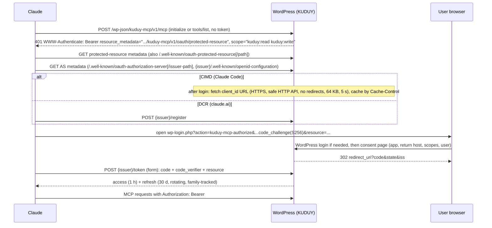

# KUDUY MCP — Architecture

Approved 2026-11-04 (decisions D1–D6); D1 and D2 changed by user decision during Phase 3. This file describes what is **built** (Phase 3 foundation and the start of Phase 4, v0.2.0) and what is **designed but not built yet** (marked *planned*). Research behind each decision: `RESEARCH.md`.

## 1. Goals and non-goals

- Native PHP WordPress plugin, GPL-2.0-or-later, no KUDUY cloud service, no Node.js on the WordPress host.
- MCP **2026-07-28 and 2025-11-25** (dual-era) over Streamable HTTP at `https://<site>/wp-json/kuduy-mcp/v1/mcp`.
- OAuth 2.1 authorization server inside WordPress; every tool runs **as the WordPress user who approved the connection**, limited by that user's capabilities and the granted scopes.
- Self-update from GitHub Releases of `kuduyDigital/KuDiagnostics`.
- Non-goals for v1: arbitrary shell execution by default; network-wide multisite administration (see §12).

## 2. Decisions

| ID | Decision | Status |
|---|---|---|
| D1 | MCP wire layer: **own thin JSON-RPC layer** (`src/Mcp/`) behind a `ToolRegistry`. `wordpress/mcp-adapter` 0.7 deprecates bundling, and exposing tools as core Abilities would let other MCP servers call them without our OAuth scopes. | Changed 2026-11-04 (user). Built. |
| D2 | OAuth core: **own minimal authorization server** (`src/OAuth/`). `league/oauth2-server` 9.4 needs PHP 8.2 and lacks `resource`, CIMD, revocation and family revoke. | Changed 2026-11-05 (user). Built. |
| D3 | Minimum PHP 8.1, WordPress 6.9; tested up to 7.1.4 | Built |
| D4 | Code execution off by default: only with `define( 'KUDUY_MCP_ALLOW_CODE_EXEC', true )` + scope `kuduy:code` + `manage_options` and `unfiltered_html`/`edit_plugins` | **Built 2026-11-10:** `kuduy-dev-file-write`, `kuduy-dev-php` (D21; tests run with the constant in their own CI job) |
| D5 | Updates via core `Update URI` + `update_plugins_github.com`; ZIP + SHA-256 asset verified before install | Built |
| D6 | Tests: local PHP + Composer for static checks, WordPress Playground CLI for integration, public HTTPS site for real Claude clients | Built (Playground + Cloudflare tunnel; user's Hostinger staging site) |
| D7 | Elementor editing: own tools on Elementor's public document API, Elementor's own MCP abilities, or a hybrid (see `docs/plans/phase-5-elementor.md`) | **Decided 2026-11-05 (user): hybrid** — own tools on the public document API for documents, v3 + v4 editing, Kit, CSS and verification; Elementor's own abilities for v4 extras (global classes, variables) on 4.3+, behind `is_available()` |
| D8 | SEO writes: own adapters on each plugin's save path, the plugins' own Abilities, or a hybrid (see `docs/plans/phase-6-seo.md`) | **Decided 2026-11-05 (user): hybrid** — plugin Abilities where complete and always on (AIOSEO, SEOPress, Rank Math reads); the plugin's own save path otherwise (Rank Math `updateMeta`, Yoast `WPSEO_Meta` + Surfaces API); one normalized field set; unsupported fields refused |
| D9 | Background jobs: own `kuduy_jobs` table + Action Scheduler / WP-Cron runner, or the MCP Tasks extension | **Decided 2026-11-05 (user): own table + runner** — `kuduy_jobs` (DB version 2), Action Scheduler when loaded, else WP-Cron; runs as the starting user, re-checks capability per item, stops on revoke, cancellable |
| D10 | WooCommerce data path: own tools on the WooCommerce CRUD API (A), or WooCommerce's own 7 abilities where they exist + CRUD for the rest (B) (see `docs/plans/phase-7-woocommerce.md`) | **Decided 2026-11-08 (user): A** (CRUD only; permission checks through WooCommerce's `wc_rest_check_*_permissions()`) |
| D11 | Money and customer-facing Woo actions: refunds, order creation, payment changes not offered; status changes/customer notes that email customers confirm-first (A), or A + record-only refunds (B) | **Decided 2026-11-08 (user): A** |
| D12 | Customer personal data: masked by default, full only with `include_pii` + per-object capability, never in audit rows (A), or full data to anyone with the capability (B) | **Decided 2026-11-08 (user): A** |
| D13 | Scopes for Woo tools: existing `kuduy:read` / `write` / `admin` (A), or a new `kuduy:shop` scope (B) | **Decided 2026-11-08 (user): A** |
| D14 | ACF data path: own tools on ACF's public API, definitions read only (A); A + definition writes through ACF's abilities when the site enabled them (B); raw post meta (C) (see `docs/plans/phase-7-acf.md`) | **Decided 2026-11-09 (user): A** |
| D15 | Forms data path: own tools on each plugin's public PHP API with one shared `kuduy-forms-*` tool set (A); the plugins' own abilities where on + own tools for the rest (B); read only (C) (see `docs/plans/phase-7-forms.md`) | **Decided 2026-11-09 (user): A** |
| D16 | What forms tools may change: inbox actions with undo, CF7 form edits, mail routing confirm-first under `kuduy:admin`, no permanent delete (A); A with mail routing refused (B); nothing (C) | **Decided 2026-11-09 (user): A** |
| D18 | Site Editor data path: core REST controllers in-process with `rest_do_request()` as the user (A); core PHP functions (B) (see `docs/plans/phase-7-site-editor.md`) | **A — built 2026-11-10 with the recommended option under the user's standing instruction (finish Phase 7 unattended); for review** |
| D19 | Cache purges: each cache plugin's documented purge API, whole site / one post / one URL, object-cache flush for admins, no snapshot (A); only a whole-site purge (B) (see `docs/plans/phase-7-cache.md`) | **A — built 2026-11-10 under the same standing instruction; for review** |
| D20 | Multilingual: Polylang's public `pll_*` API, WPML later with a licensed copy (A); Polylang + WPML hooks now (B) (see `docs/plans/phase-7-multilingual.md`) | **A — built 2026-11-10 under the standing instruction; for review** |
| D21 | Developer mode: read-only file, log and database tools for site administrators (admin scope); code tools (file write, PHP) only behind D4 (A); read tools only (B); everything behind D4 (C) (see `docs/plans/phase-7-developer.md`) | **A — built 2026-11-10 under the standing instruction; for review (please review before enabling D4 on any site)** |
| D22 | Custom post types and taxonomies: definitions stored by KUDUY and registered on `init` (A); ACF post types (B); a generated plugin (C) (see `docs/plans/phase-7-content-types.md`) | **A — built 2026-11-10 under the standing instruction; for review** |
| D23 | Hidden UI mode: option + Tools-page "Hide" action for administrators, recovery by option, WP-CLI or constant, nothing readable by the MCP runtime (A); also an MCP tool to toggle it (B) | **A — built 2026-11-10 with the recommended option (road-to-1.0 instruction); for review** |
| D24 | WooCommerce shipping/tax writes: WooCommerce's own wc/v3 controllers in-process (validation + `manage_woocommerce`), admin scope, undo, tax-rate delete undone by re-creating (A); direct CRUD (B) | **A — built 2026-11-10 (road-to-1.0 instruction); for review** |
| D25 | Rank Math redirects/schema + sitemap status: Rank Math's own Redirection/DB classes (redirects, admin scope, `rank_math_redirections`, trash not delete) and its updateSchemas/updateMeta routes (schema, `edit_post`), undo by meta id; sitemap from each plugin's own setting or ability (A); read only (B) | **A — built 2026-11-10 (road-to-1.0 instruction); for review** |
| D26 | Media replace/rename: replace keeps id and file name (same type, https download, sizes regenerated); rename refuses while linked by URL in content or Elementor; both back up the old files to uploads/kuduy-backups for undo, pruned with snapshots (A); rename also rewrites links (B) | **A — built 2026-11-10 (road-to-1.0 instruction); for review** |
| D27 | Product name: the display name is **KuDiagnostics** (plugin header, admin page, notices, MCP server title, docs); the internal slug `kuduy-mcp`, folder, text domain, tool names, connector URL, options and constants stay, so installed sites keep updating and connected clients keep working | **Decided 2026-11-10 (user)** — personal-use plugin; a full internal rename stays possible later |
| D17 | Visitors' personal data in entries: masked by field type, full with `include_pii` + entry-edit permission, never in audit rows (A); every value masked unless `include_pii` (B) | **Decided 2026-11-09 (user): A** |

## 3. Components

```mermaid
flowchart LR
  subgraph Clients
    A["claude.ai / Desktop / mobile"]
    B["Claude Code"]
  end
  subgraph WP["WordPress + KUDUY MCP"]
    G["Http/OutputGuard: buffer on own routes"]
    O["OAuth: metadata, authorize, token, register, revoke"]
    T["OAuth/TokenAuth: determine_current_user + route guard"]
    M["Mcp/RestController + Server: dual-era JSON-RPC"]
    R["Mcp/ToolRegistry"]
    P["Policy: scope, capability, rate limit"]
    X["Mcp/Executor: validate, check, snapshot, run, redact, audit"]
    subgraph Modules
      C["Core (built: site info, snapshots, update check)"]
      E["Elementor (planned)"]
      S["SEO (Rank Math, Yoast) + media (built in part)"]
      W["WooCommerce + integrations (planned)"]
      D["Developer mode (planned)"]
    end
    J["Jobs (planned)"]
    L[("Audit log")]
    K[("Snapshots")]
    U["Update/GitHubUpdater"]
    H["Admin: Tools > KUDUY MCP (hidden mode planned)"]
  end
  A & B -->|HTTPS| G --> O
  G --> T --> M --> R --> P --> X --> Modules
  X --> L
  X --> K
  Modules --> J
  U -->|releases API| GH[("github.com/kuduyDigital/KuDiagnostics")]
```



## 4. Folder structure (as built)

```
kuduy-mcp/                       repo root = plugin root
├─ kuduy-mcp.php                 header (Version, Requires, Update URI), autoload, OutputGuard, hooks
├─ uninstall.php                 keeps data unless KUDUY_MCP_DELETE_DATA_ON_UNINSTALL
├─ src/
│  ├─ Plugin.php                 wiring only (VERSION, boot, hooks)
│  ├─ Lifecycle/                 Migrations (dbDelta, DB_VERSION), Deactivator, Uninstaller, Cleanup (daily cron)
│  ├─ Http/OutputGuard.php       drops stray output on our routes; 202/405 without body
│  ├─ Mcp/                       Tool, ToolError, ToolRegistry, Executor, Server, RestController
│  ├─ OAuth/                     Urls, Scopes, Clients (DCR + CIMD), Tokens, TokenAuth, Authorize, Endpoints
│  ├─ Policy/RateLimiter.php
│  ├─ Execution/                 Snapshottable, Snapshots
│  ├─ Audit/                     AuditLog, Redactor
│  ├─ Admin/                     Connections, ConnectionsPage (Tools > KUDUY MCP)
│  ├─ Update/GitHubUpdater.php
│  ├─ Modules/Core/              SiteInfo, SnapshotList, SnapshotRestore, CheckUpdate, Content (shared), PostTypes, PostList, PostGet, TermList, … (Phase 4 tools)
│  ├─ Modules/Elementor/         Elementor (shared), ElementorRead, ElementorWrite, ElementorVerify, ElementorAbilities, ThemeBuilder, Tree
│  ├─ Modules/Seo/               Seo (resolver), SeoAdapter, RankMathAdapter, YoastAdapter, AioseoAdapter, SeopressAdapter, SeoTools, SeoVerify
│  ├─ Modules/Media/             MediaTools, MediaLibrary
│  ├─ Modules/Acf/               Acf (objects, location screen, field resolution, validation), AcfTools
│  ├─ Modules/Forms/             Forms (registry), FormsAdapter + Cf7Adapter (CF7 + Flamingo), FluentAdapter, WpformsAdapter; Mask; FormsTools, FormEntries, Cf7Save
│  ├─ Modules/Woo/               Woo (field map, attributes, permissions), Pii, WooStatus, ProductRead, ProductWrite, VariationWrite, OrderRead, OrderWrite, CouponTools, CustomerTools, ReviewTools, StoreSettings, Report
│  └─ Jobs/                      Jobs (store + runner), JobTools
├─ scripts/                      test-integration, smoke-mcp, tunnel, build-release, check-release, check-update
├─ tests/integration/            PHPUnit inside Playground; tests/playground blueprint; tests/phpstan stub
└─ .github/workflows/            ci.yml, release.yml
```

*Planned:* `src/Modules/{Blocks/, Dev/}`, `assets/admin/`, `languages/`. Rule: modules depend on `Mcp\Tool`, `Policy` and `Execution`, never on each other — except the shared `Modules\Core\Content` helper (post types with an admin UI, post lookup), which every content module uses.

## 5. Database schema (DB version 2)

Custom tables only where options or meta do not fit (high write volume, queries, revocation). Created by `Lifecycle\Migrations` on activation and on boot when the stored version is older (auto-updates do not run activation hooks).

| Table | Columns | Why a table |
|---|---|---|
| `{p}kuduy_oauth_clients` | `client_id` PK, `type` (dcr/cimd), `name`, `redirect_uris` JSON, `metadata_url`, `metadata_cache` JSON, `created_at`, `last_used_at` | Many DCR rows; CIMD cache |
| `{p}kuduy_oauth_codes` | `code_hash` PK, `client_id`, `user_id`, `redirect_uri`, `scope`, `resource`, `challenge`, `expires_at`, `used` | Single use, 5 min |
| `{p}kuduy_oauth_tokens` | `id`, `token_hash` UNIQUE, `type` (access/refresh), `family_id`, `client_id`, `user_id`, `scope`, `resource`, `expires_at`, `revoked_at`, `replaced_by` | Rotation, reuse detection, revocation |
| `{p}kuduy_audit_log` | `id`, `ts`, `user_id`, `client_id`, `tool`, `args_redacted`, `result` (ok/error/denied), `error_code`, `duration_ms`, `object_type`, `object_id`, `snapshot_id` | High write, filterable, retention |
| `{p}kuduy_snapshots` | `id`, `ts`, `user_id`, `tool`, `object_type`, `object_id`, `payload` (`{"input":…, "state":…}`), `restored_at` | Undo of destructive changes |
| `{p}kuduy_jobs` (DB 2) | `id`, `created_at`, `updated_at`, `user_id`, `client_id`, `scopes`, `tool`, `status` (queued/running/done/cancelled/stopped/failed), `total`, `done`, `failed`, `error`, `items` JSON, `results` JSON | Background jobs (D9); finished jobs removed with snapshots (30 days) |

Only SHA-256 hashes of codes and tokens are stored. Options: `kuduy_mcp_db_version`; site transients `kuduy_mcp_release` (update cache) and `kuduy_mcp_rl_*` (rate limit). *Planned options:* `kuduy_mcp_hidden_mode`, `kuduy_mcp_settings`. Retention (`Cleanup`, daily): audit 90 days, snapshots 30 days, expired codes/tokens after 1 day, unused clients after 30 days (filters `kuduy_mcp_audit_retention_days`, `kuduy_mcp_snapshot_retention_days`).

## 6. MCP layer and tool registry

`RestController` (route `kuduy-mcp/v1/mcp`: POST; GET/DELETE → 405 `Allow: POST`) validates Origin (site origin, `https://claude.ai`, `https://claude.com`, filter `kuduy_mcp_allowed_origins`), turns bad JSON into `-32700`, and hands the body plus `MCP-Protocol-Version` / `Mcp-Method` / `Mcp-Name` to `Server`.

`Server` rules:

- Modern (body `_meta` has `io.modelcontextprotocol/protocolVersion`): headers must match the body (`-32020`, 400), version must be `2026-07-28` (`-32022`, 400, `data.supported`), `server/discover`, `tools/list`, `tools/call`; unknown method → 404 `-32601`; results carry `resultType: complete` and `_meta` serverInfo; `server/discover` and `tools/list` add `ttlMs: 0`, `cacheScope: private`.
- Legacy: `initialize` (negotiates 2025-11-25 / 2025-06-18 / 2025-03-26, no session), `ping`, `tools/list`, `tools/call`; method errors stay HTTP 200.
- `initialize`, `tools/list` and `tools/call` need a signed-in user: 401 + `WWW-Authenticate` challenge otherwise. `server/discover` stays open.
- Notifications → 202 with no body. Batches rejected.

Tool contract (`src/Mcp/Tool.php`):

```php
interface Tool {
    public function name(): string;              // kuduy-*, [a-z0-9-], ≤ 64 chars
    public function title(): string;
    public function description(): string;
    public function input_schema(): array;       // JSON Schema, validated with core rest_validate_value_from_schema()
    public function output_schema(): array;      // JSON Schema of structuredContent, listed as outputSchema
    public function annotations(): array;        // readOnlyHint, destructiveHint, idempotentHint, openWorldHint
    public function scope(): string;             // kuduy:read | kuduy:write | kuduy:admin | kuduy:code
    public function capability( array $input ): string|array; // 'read' or [ 'read_post', 42 ] for object checks
    public function is_available(): bool|string; // true, or why not (e.g. "Elementor is not active")
    public function execute( array $input ): array;
}
```

`ToolRegistry::create()` registers core tools and fires `kuduy_mcp_register_tools`. `Executor::allowed()` is the one capability check (listing, calling, undo). `Executor::call()` order: availability → schema validation + sanitizing → `Executor::allowed( tool, input )` → snapshot if `Snapshottable` and `destructiveHint` → execute → `Redactor` → audit row. Exceptions become a generic tool error (`isError: true`) plus an `error_log` line with class/file/line only. `Server` checks the OAuth scope (403 `insufficient_scope`) and the rate limit (429 `Retry-After`) before the executor. Unavailable tools are hidden unless `KUDUY_MCP_LIST_UNAVAILABLE`.

Tools name the object they touch with `AuditLog::target( type, id )` (snapshots do it automatically), so audit rows carry `object_type` / `object_id`. Content tools share `Modules\Core\Content`: only post types and taxonomies with an admin UI (`show_ui`), attachments excluded until media tools, a post summary that never contains the post password, paging (1–100 per page).

## 7. OAuth and authentication flow



- HTTPS: authorize, token, registration and bearer tokens are refused over plain HTTP unless the site is local (loopback, `*.localhost`, `*.test`, `WP_ENVIRONMENT_TYPE=local`; filter `kuduy_mcp_require_https`). `Urls` builds REST URLs without `$wp_rewrite` when called before WordPress creates it.
- Issuer = `rest_url( 'kuduy-mcp/v1/oauth' )`, so `{issuer}/.well-known/openid-configuration` works on hosts that block `/.well-known/`. Root `/.well-known/` documents are also served from `init` when the host passes them to WordPress.
- Public clients only (`token_endpoint_auth_method: none`). S256 only. Exact redirect match, except loopback (`localhost`, `127.0.0.1`, `[::1]`) on any port.
- Codes: single use (atomic claim); reuse revokes the tokens issued from that code. Refresh: rotation; reuse of a rotated/revoked refresh revokes the whole family. Revocation (RFC 7009) always 200; revoking a refresh token ends the connection.
- `TokenAuth` (`determine_current_user`, priority 30, after cookie and Application Password): accepts `kmcp_at_` tokens only when the request path is exactly the MCP endpoint (or the site root with `rest_route=/kuduy-mcp/v1/mcp` on plain permalinks) and no other `rest_route` is present; a bad token yields user 0. `rest_pre_dispatch` refuses a token on any other route (401 `kuduy_mcp_token_route`) for the request's first dispatch; internal `rest_do_request()` calls by tools stay allowed.
- Logged-out visitors are sent to login before any client lookup, so anonymous requests never trigger a CIMD fetch.
- DCR is bounded by the number of unused clients (filter `kuduy_mcp_registration_limit`, default 1000; unused clients older than 1 h are evicted first), not by IP.
- Consent page: `X-Frame-Options: DENY`, CSP `frame-ancestors 'none'`, nonce; unticked scopes are not granted; no ticked scope → `access_denied`.
- Application Passwords and cookie+nonce logins also work; they are limited by capabilities only (no OAuth scope).

## 8. Permission model

All layers must pass:

1. **OAuth scope** granted at consent: `kuduy:read` ⊂ `kuduy:write` ⊂ `kuduy:admin`; `kuduy:code` separate and only offered when D4's constant is set. Offered scopes are cut to what the user can do (`read`, `edit_posts`, `manage_options`, + `unfiltered_html`/`edit_plugins` for code). Requested scopes are ticked; `kuduy:admin`, when not requested, is still offered unticked to users with `manage_options` (claude.ai requests none, so it would otherwise never get admin tools). `kuduy:code` is only offered when requested.
2. **Token binding**: a token works only on the MCP route (§7).
3. **WordPress capability** per tool and per object: `current_user_can( $tool->capability( $input ) )`.
4. **Undo** (`kuduy-snapshot-restore`) needs the original tool's scope and its capability for the saved input; only the snapshot's owner or a site manager; each snapshot restores once.
5. **Rate limit**: 120 calls per minute per user + client (filter `kuduy_mcp_rate_limit`).
6. **Safety policy** (*planned with Phase 4 tools*): never deactivate KUDUY itself; switching theme or deactivating essential plugins needs `confirm: true` after an impact report; high-risk Woo actions (refunds, payment changes) are not offered.
7. **Redaction** on every tool result and audit row (`Audit\Redactor`). Tools whose arguments carry personal data implement `Audit\MasksAuditArgs`; the executor stores their masked arguments in the audit row and the snapshot input (D12). The snapshot payload itself still holds the previous values that undo needs (owner or site manager only, removed after 30 days).

## 9. Integration adapters (planned, Phases 5–7)

- **Elementor**: schema providers for v3 (`get_controls()`, incl. `_tablet` / `_mobile` keys) and v4 atomic (`get_props_schema()`); add-on adapters declare widget prefixes and non-standard settings. Edits are patches (set/unset keys per breakpoint). Save through `Document::save()`, snapshot first, regenerate that post's CSS, fetch the permalink and confirm the edited element IDs/text appear. Report partial failures.
- **SEO** (built, D8): `Modules/Seo/` — `Seo` resolver (detects Rank Math, Yoast, AIOSEO, SEOPress by their version constants; exactly one may receive writes; two or more → refused with every name; an adapter's `ready()` refuses a plugin that is installed but not set up; `Seo::ability()` runs a plugin ability as the current user), `SeoAdapter` interface (flat normalized fields `title`, `description`, `focus_keyword`, `additional_keywords`, `canonical`, `cornerstone`, `robots.*`, `og.*`, `twitter.*`; `stored()`, `rendered()`, `missing_caps()`, `write()`, `snapshot()` / `restore()`), `SeoTools` (`kuduy-seo-status`, `-get`, `-update`), `SeoVerify` (`kuduy-seo-verify`: fetches the published page, reads its head with core's `WP_HTML_Tag_Processor`, compares with expected values). Adapters: Rank Math (reads its editor's meta keys, writes through its own `rankmath/v1/updateMeta` endpoint via `rest_do_request()`, rendered values from its `rank-math/get-post-seo-meta` ability); Yoast (`WPSEO_Meta` get/set/delete, indexable rebuilt at once through its post watcher, rendered values from the Surfaces API); AIOSEO (only its abilities `aioseo-posts/seo-data-get` / `-update`, because its data lives in its own table; rendered title/description from its meta classes); SEOPress (its `seopress/get-post-…` / `update-post-…` abilities, target keywords through its `seopress/v1/posts/{id}/target-keywords` route; no rendered values outside a front-end request). *Planned:* schema, sitemap, redirects, term SEO.
- **Image SEO** (built): `Modules/Media/MediaTools` — `kuduy-media-list` (`upload_files`; filters: type, search, unattached, missing alt), `kuduy-media-get` (`read_post`; with `include_image` a stored size ≤ 1024 px, or a temporary downscaled copy, returned as an MCP image block so Claude writes alt text from the image), `kuduy-media-update` (`edit_post`; alt via core's `_wp_attachment_image_alt` sanitized like core's REST controller, title/caption/description via `wp_update_post()`; `decorative` = empty alt; snapshot + undo). `Modules/Media/MediaLibrary` — `kuduy-media-usage` (featured image, content by `wp-image-N` class or file URL, Elementor data by id or URL, WooCommerce galleries, site icon/logo; prepared read-only searches; only posts the user can read), `kuduy-media-upload` (HTTPS only, `download_url()` = `wp_safe_remote_get()`, raster images ≤ 10 MB checked by content, `media_handle_sideload()`), `kuduy-media-regenerate` (`wp_generate_attachment_metadata()` from the original). Tools may return extra MCP content under the reserved result key `_content`; the executor passes only base64 image blocks of JPEG/PNG/GIF/WebP and keeps them out of `structuredContent`. *Planned:* replace image, safe rename, optimization through installed tools.
- **ACF** (Phase 7, D14 A, built): `Modules/Acf/` — fields of groups ACF shows on the object (the location screen ACF's REST API builds: `post_id`; `user_id` + `rest`; `taxonomy`; without its `show_in_rest` filter), resolved by key or name, validated with `acf_validate_value()` plus a choices check, written with `update_field( $key, … )` (never a free name, so no dummy meta); undo keeps the previous raw value or deletes values that did not exist; `password` fields never returned and masked in audit rows (`MasksAuditArgs`); field groups read only. `kuduy-post-meta-set` refuses ACF field names with a pointer to `kuduy-acf-update` (ACF 6.8.11 also denies `edit_post_meta` on them).
- **WooCommerce** (Phase 7, in progress; *built:* `kuduy-woo-status`, products and variations — `Woo` keeps one field map for reading, writing and undo (`get_{field}( 'edit' )` / `set_{field}()`, every value set before one `save()`, `WC_Data_Exception` → tool error with nothing saved); global attributes by taxonomy with existing terms only, custom attributes free text; variation attribute values checked against the parent; `WC_Product_Variable::sync()` after variation writes; stock through `wc_update_product_stock()`; trash through `WC_Data::delete( false )`, undo through `wp_untrash_post()` (WooCommerce brings variations back) + the saved status; capability per object = `edit_post` / `delete_post` on the product (a variation's parent), plus WooCommerce's own `wc_rest_check_post_permissions()` inside each call; publishing needs `publish_products`. Orders: `wc_get_orders()` / `wc_get_order()` (both storages), read access `read_private_shop_orders`; `Pii` masks customer details (email `j***@domain`, names and country only) unless `include_pii` and `edit_post` on the order; order keys never returned; status through `update_status( …, manual )` — customer emails are found from the enabled customer `WC_Email` objects on the change's `…_notification` hooks and make the call confirm-first; `refunded` refused (WooCommerce would create a refund); undo restores the status with WooCommerce's email dispatch for that change unhooked and customer emails disabled (also covers deferred emails); notes through `add_order_note()`, customer notes confirm-first, no undo. Coupons: `WC_Coupon` getters/setters, codes unique through `wc_get_coupon_id_by_code()` (case-insensitive, published coupons only — WooCommerce's own rule), percent ≤ 100, who used a coupon never returned, allowed emails masked unless the user can edit the coupon; trash + undo like products. Customers: `WC_Customer`, read `list_users`, address changes through `set_props()` with `wc_rest_check_user_permissions( 'edit' )` (shop manager: customers only); only billing/shipping addresses change. Reviews: `review` comments on products, WooCommerce's review permissions, `WC_Comments::clear_transients()` after moderation and undo, replies through `wp_new_comment()`, reviewer emails always masked. Store settings (read only): shipping zones (`WC_Shipping_Zones`, rest-of-world zone last) with methods and instance settings, tax classes and rates (`WC_Tax`), payment gateways (`kuduy:admin`) — settings fields of type `password` or with a credential-like name (`Redactor::is_secret_key()`) return `value: null` + `has_value`; all need `manage_woocommerce` + `wc_rest_check_manager_permissions()`. Reports: `wc-analytics/reports/*` through `rest_do_request()` (the namespace loads on `rest_pre_dispatch`), stats totals/intervals and list rows with `extended_info`, `Pii::scrub()` masks emails and drops street-level address, phone, user name and IP; refused while Analytics is off. *Planned (later in Phase 7):* store setting writes; integrations. tax, gateways, reports. D10–D13 decided: all A; plan `docs/plans/phase-7-woocommerce.md`, research `RESEARCH.md` §10): `Modules/Woo/`, available only when `WC_VERSION` is defined. CRUD objects only (`WC_Product*`, `WC_Order` via `wc_get_orders()`, `WC_Coupon`, `WC_Customer`, `WC_Shipping_Zones`, `WC_Tax`; reports from `wc-analytics` via `rest_do_request()`), so HPOS on and off share one code path; per-object checks through WooCommerce's own `wc_rest_check_*_permissions()`; gateway/shipping settings masked by field type `password`; customer PII masked unless allowed; no refunds, charges, order creation or permanent deletes; core post tools refuse WooCommerce post types for writes.
- **Forms** (Phase 7, D15–D17 A, built): `Modules/Forms/` — one `FormsAdapter` per plugin behind 9 shared tools (`kuduy-forms-status`, `-list`, `-get`, `-entries`, `-entry-get`, `-entry-update`, `-entry-note`, `-cf7-save`, `-cf7-mail`). Adapters read and change data only through the plugin's own classes (CF7 `WPCF7_ContactForm` + `wpcf7_save_contact_form()`; Flamingo `Flamingo_Inbound_Message`; Fluent Forms models, `fluentFormApi()` and `SubmissionService`; WPForms `wpforms()->obj( 'form' )`) and check the plugin's own permissions per form and entry (CF7 and Flamingo meta caps, Fluent `Acl::hasPermission( $perm, $form_id )`, `wpforms_current_user_can()`); the executor's capability is only the floor (`read`). Entries come back with a field kind; `Mask` hides email, phone, name, address and file values, IP and user agent unless `include_pii` and the entry-edit permission (D17 A), and never returns password fields. Entry changes (read, starred, status active/spam/trash) snapshot the previous state; undo of a Flamingo spam change clears the Akismet details for the call and puts them back, so nothing is reported. A change that Flamingo would report to Akismet, and CF7 mail routing changes (`-cf7-mail`, `kuduy:admin`), are confirm-first. No permanent delete, exports or payments. Gravity Forms is not shipped until a licensed copy is tested.
- **Others** (CPT, menus, blocks, Site Editor, widgets, cron, cache, WPML/Polylang): one module each, gated by `is_available()` with an actionable message when absent.

## 10. Hidden UI mode (built 2026-11-10, Phase 8, D23)

- Setup mode: Tools > KUDUY MCP shows the connector URL, connections (revoke), recent calls, and a **Hide UI** action.
- Hidden mode (`kuduy_mcp_hidden_mode = 1`) removes KUDUY's menu, pages, dashboard widget, notices, admin-bar node and plugin-row links. Direct hits on hidden page slugs redirect to the dashboard. The plugin row stays in Plugins.
- Only `Admin/*` reads the option; transport, OAuth, registry, modules, jobs, audit and updater are wired independently. A test asserts identical tool lists and working OAuth in both modes.
- Recovery (needs server or admin access, no secret bypass): `wp option update kuduy_mcp_hidden_mode 0`, `wp kuduy ui show`, or `define( 'KUDUY_MCP_SHOW_UI', true )` in `wp-config.php`.
- Built as `Admin/HiddenMode` (option, admin-post "Hide" action with nonce + `manage_options`, redirect of the page slug, section on the Tools page) and `Admin/Cli` (`wp kuduy ui show|hide|status`). There is no MCP tool to hide or show the UI, and no "show" button while hidden. There is no dashboard widget, admin-bar node or plugin-row link today; the Tools page and the permalink notice are all that is hidden.

## 11. GitHub self-update (built)

- Header `Update URI: https://github.com/kuduyDigital/KuDiagnostics`; core filter `update_plugins_github.com` for our file only; fallback on `site_transient_update_plugins` because core skips Update URI plugins when wordpress.org is unreachable.
- `GET /repos/kuduyDigital/KuDiagnostics/releases/latest` (beta channel: `/releases?per_page=10`), cached 12 h in a site transient with ETag; 1 h retry after failures. "Check again" on Dashboard → Updates bypasses the cache (only for users who can `update_plugins`).
- Release contract: tag `vX.Y.Z`, assets `kuduy-mcp.zip` (top folder `kuduy-mcp/`) and `kuduy-mcp.zip.sha256`. `upgrader_pre_download` downloads both and refuses a mismatch. `plugins_api` fills the details modal (escaped notes). Tool `kuduy-check-update` (cap `update_plugins`) reports, never installs.
- Limit: the checksum comes from the same release, so it proves integrity, not authorship. Later option: Ed25519 signature with an embedded public key.

## 12. Background jobs (built), developer mode, multisite (planned)

- **Jobs** (built, D9): `Jobs/Jobs` stores a job in `kuduy_jobs` and runs it in batches (25 items or 20 s) on the `kuduy_mcp_run_job` hook — Action Scheduler (`as_enqueue_async_action`) when loaded, otherwise a single WP-Cron event plus `spawn_cron()`. Every item goes through `Executor::call()` as the owner (availability, schema, capability per item, snapshot, redaction, audit). Before each item the runner checks: not cancelled, owner exists, the granted scopes still cover the tool, the OAuth connection that started it still has a live refresh token. `Jobs/JobTools`: `kuduy-job-start` (only `kuduy-seo-update`, `kuduy-media-update`, `kuduy-media-regenerate`, `kuduy-woo-product-update`, `kuduy-woo-variation-update`, `kuduy-woo-product-stock`, `kuduy-woo-coupon-update`, `kuduy-acf-update` — nothing that emails customers or trashes; up to 500 items, each validated against the tool's schema before anything starts), `kuduy-job-status`, `kuduy-job-cancel` (owner or `manage_options`). Deactivation and uninstall unschedule the hook.
- **Developer mode** (Phase 7, D4): read-only by default — file read/search inside ABSPATH minus `wp-config.php` and secret patterns, DB schema + capped `SELECT` via `$wpdb->prepare` with secret columns masked, hooks inspector, approved logs redacted. Writes only under themes, plugins and a KUDUY sandbox dir, snapshot first, PHP parse check, crash marker + safe-mode boot. Code exec / WP-CLI only with D4 constant + `kuduy:code`, time-limited, fully audited.
- **Multisite**: today each site activates separately and gets its own tables (`$wpdb->prefix`); migrations self-heal per site on boot. Uninstall currently only cleans the site it runs on. Network-wide behaviour is **not designed or tested** yet (FEATURES lists it).

## 13. Compatibility and tests

Tested versions and environments: `COMPATIBILITY.md`. Test strategy, feature matrix and results: `TESTING.md`. Threat model and controls: `SECURITY.md`.
